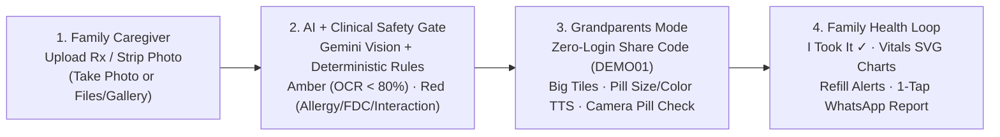

# NaniCare

> **A voice-first, iOS Assistive Access–inspired medication safety companion for older adults — paired with an AI prescription verification gate, Indian clinical safety engine, and family vitals loop.**

[](LICENSE)
[](.github/workflows/ci.yml)
[](.github/workflows/codeql.yml)

**Live Demo:** [nani-care.vercel.app](https://nani-care.vercel.app/) *(Zero-login Share Code: `DEMO01`)* · **API Docs:** [nanicare.onrender.com/docs](https://nanicare.onrender.com/docs) · **Demo Runbook:** [docs/DEMO_SCRIPT.md](docs/DEMO_SCRIPT.md)

**Quick Navigation:**
[Why NaniCare](#why-nanicare-is-needed) · [How It Works](#how-it-works) · [Safety & AI Architecture](#safety--ai-architecture) · [Key Features](#key-features) · [Assumptions & Scope](#assumptions--scope) · [Project Structure](#project-structure) · [Run Locally](#run-locally) · [API Reference](#backend-api-endpoints) · [Testing](#testing--verification) · [Deployment](#deployment--ci)

> **Clinical Disclaimer:** NaniCare is a medication organization, visual identification, and adherence tool. It does not replace a licensed clinician's judgment. Always confirm extracted details against the original prescription and follow your doctor's instructions.

---

## Why NaniCare Is Needed

Millions of older adults manage complex daily pill regimens alone — often with declining eyesight, memory lapses, look-alike foil strips, and tiny English labels printed on handwritten prescriptions.

| The Problem in Numbers | Source |
| :--- | :--- |
| **~50% adherence globally:** Only half of patients with chronic illnesses take medicines as prescribed — and rates drop lower in developing nations. | World Health Organization (WHO), *Adherence to Long-Term Therapies* |
| **75% chronic burden in India:** Around **3 in 4** older Indians live with at least one chronic condition, and **over 33%** in urban cohorts juggle polypharmacy (5+ daily medicines). | *Longitudinal Ageing Study in India (LASI Wave-1)* & PIB / NIH studies |
| **8.5% living alone:** Rapid urbanization and nuclear families leave roughly **1 in 12** older Indians ageing solo without daily bedside help to sort morning vs. night pills. | *LASI* secondary demographic analyses |
| **600,000+ ER visits & ~100,000 hospitalizations/year (65+):** Older adults are **~7× more likely** to be hospitalized after an adverse drug event than younger adults — roughly **two-thirds** caused by unintentional dosing errors. | U.S. Centers for Disease Control and Prevention (CDC, NEISS-CADES) |

**The real gap:** Caregiver apps give charts to young adults, while senior citizens are handed cluttered, tiny-font dashboards — or raw AI chatbots that can hallucinate dosages. **NaniCare bridges both sides:** Gemini Vision accelerates data entry for the family caregiver, a **deterministic safety & human verification gate** blocks unsafe guesses, and the grandparent gets a calm, big-tile visual & voice companion in **Hindi, Marathi, or English**.

---

## How It Works



1. **Scan & Flag ([Caregiver Mode](frontend/src/pages/caregiver/index.tsx)):** A family member chooses **Take Photo** or **Choose from Files / Gallery** ([PrescriptionScanner.tsx](frontend/src/components/PrescriptionScanner.tsx)). Large phone photos are downscaled client-side ([image.ts](frontend/src/utils/image.ts)) and sent with the active `share_code` to `POST /scan`. [backend/engine.py](backend/engine.py) extracts medicines and runs [backend/scheduler.py](backend/scheduler.py) to highlight handwritten ambiguities in **amber** and allergy, interaction, or hidden-FDC conflicts in **red**.
2. **Verify & Publish ([ReviewMedicineCard.tsx](frontend/src/components/ReviewMedicineCard.tsx)):** Unverified drafts are strictly locked out of the elder's view. Once confirmed, NaniCare generates IST meal-aligned slots, **0-token SVG strip previews** ([backend/visuals.py](backend/visuals.py)), and spoken EN/HI/MR scripts describing **pill size, color, shape, and strip color**.
3. **Guided Elder Routine ([Grandparents Mode](frontend/src/pages/nani/index.tsx)):** Modeled after **Apple iOS 17 Assistive Access**, the elder opens their schedule with a 6-character code (`DEMO01`) and sees distraction-free big tiles (`Medicines Now`, `Today's List`, `Hear Medicines`, `Check My Pill`, `Talk`, `Call Family`).
4. **Monitor & Share ([Vitals & Refills](frontend/src/pages/vitals/index.tsx)):** Every dose and vital reading updates live **Blood Pressure, Temperature, Weight, and 7-day Adherence** graphs ([VitalsCharts.tsx](frontend/src/components/VitalsCharts.tsx)), triggers refill countdowns, and builds a 1-tap **WhatsApp Daily Family Report** (`GET /profile/{share_code}/summary`).

---

## Safety & AI Architecture

| Safety Layer | How It Protects Elders | Implementation |
| :--- | :--- | :--- |
| **Human Verification Gate** | Medicines with `confidence < 0.80` or missing strength are highlighted in **amber**; unverified items never reach Grandparents Mode. | [engine.py](backend/engine.py), [ReviewMedicineCard.tsx](frontend/src/components/ReviewMedicineCard.tsx) |
| **Scan-Time Allergy Check** | Passes `share_code` during `POST /scan` to cross-check patient `known_allergies` (Penicillin, Cephalosporin, Sulfa, Aspirin/NSAID, Paracetamol, Statin) and flag **red** immediately. | [scheduler.py](backend/scheduler.py), [api.ts](frontend/src/lib/api.ts) |
| **Indian FDC & Beers Criteria** | Catches hidden Paracetamol in Indian FDCs (`Zerodol-P`, `Hifenac-P`, `Combiflam`, `Ultracet`, `Sumo`, `Sinarest`, `Wikoryl`), Sulfonylurea FDCs (`Glycomet-GP`, `Glimestar`), and **AGS Beers Criteria fall-risk sedatives** (`Alprax`, `Ativan`, `Zolfresh`, `Avil`, `Atarax`). | [scheduler.py](backend/scheduler.py) |
| **Wrong-Strength Strip Guard** | **Check My Pill** (`POST /scan/verify-strip`) compares detected strip strength against the prescribed dose (e.g., `Thyronorm 100 mcg` vs `50 mcg`) and **fails closed** (`matched: false`) if live Vision is unavailable. | [engine.py](backend/engine.py) |
| **Fast, Bounded Vision Fallback** | Cycles `gemini-2.5-flash` → `gemini-flash-latest` → `gemini-2.5-flash-lite` → `gemini-flash-lite-latest` → `gemini-3-flash-preview` with `HttpRetryOptions(attempts=1)`, 18s per-model timeout, 35s total budget, and `asyncio.to_thread` offloading. | [engine.py](backend/engine.py), [server.ts](frontend/server.ts) |
| **Hardened Web & API Security** | Security headers (`nosniff`, `DENY`, `HSTS` on Vercel), sliding-window IP rate limiting (`429` + `Retry-After`), sanitized error messages, and React `ErrorBoundary`. | [engine.py](backend/engine.py), [vercel.json](frontend/vercel.json), [ErrorBoundary.tsx](frontend/src/components/ErrorBoundary.tsx) |

---

## Key Features

### 1. Grandparents Mode (iOS 17 Assistive Access–Inspired UX)
- **Zero-Login Share Code Access:** Connects directly via a 6-character family code (default `DEMO01` for Kamla Sharma) — no passwords, emails, or OTPs.
- **Distraction-Free Full-Screen Chrome:** Hides navigation bars and footers inside [App.tsx](frontend/src/App.tsx) when Grandparents Mode is active, leaving only oversized tiles and one prominent **Back** button (`Escape` supported).
- **One Task Per Screen:**
  - **Medicines Now:** Shows one medicine at a time for the active slot with dot progress indicators and Next/Back controls ([NaniMedicineCard.tsx](frontend/src/components/NaniMedicineCard.tsx)).
  - **Today's List:** Scrollable daily checklist grouped by slot with strip pictures and instant green **"I Took It" (`✓`)** toggles.
  - **Hear Medicines / Stop:** Neural Indian MP3 speech (`POST /tts` via `edge-tts`) with background prefetching ([tts.ts](frontend/src/utils/tts.ts)) and browser `speechSynthesis` fallback.
  - **Check My Pill (Camera/Upload):** Snaps or picks a pill strip (`POST /scan/verify-strip`) and speaks a clear green **YES** or red **STOP** verdict (including wrong-strength warnings) in EN/HI/MR.
  - **Talk (Hands-Free Voice Commands):** Listens in `en-IN`, `hi-IN`, or `mr-IN` for keywords like *"Morning"*, *"Night"*, *"Taken"*, *"Help"*, or regional equivalents (`सुबह`, `रात`, `लिया`, `मदद`, `सकाळ`, `रात्र`, `घेतले`, `मदत`).
  - **Call Family:** Pre-filled `tel:` emergency dialer and 1-tap WhatsApp SOS alert ([whatsapp.ts](frontend/src/utils/whatsapp.ts)).
  - **Settings:** Root `rem` text scaling (`A` / `A` / `A`), **AAA High Contrast** toggle (4px black/white borders), **Grid vs. Rows** layout switcher, language switcher (`English` / `हिन्दी` / `मराठी`), and Share Code loader.
- **Non-Textual Visual Cues:** Sunrise / Sun / Moon icons for time of day, pill-before-plate / plate-before-pill meal pictograms, tablet-count icons, completion dots, and haptic vibration on confirm.

### 2. Caregiver Mode (Dual AI Accuracy & Verification Gate)
- **Quick Family Profile Setup ([ModeSelect.tsx](frontend/src/components/ModeSelect.tsx)):** Create an elder profile or load an existing Share Code (or `DEMO01`) right from the start screen.
- **Mobile-Friendly Upload Chooser ([PrescriptionScanner.tsx](frontend/src/components/PrescriptionScanner.tsx)):** Explicit **Take Photo** vs. **Choose from Files / Gallery** options so mobile browsers never trap caregivers in camera-only mode, paired with client-side photo resizing ([image.ts](frontend/src/utils/image.ts)).
- **Indian Prescription & Shorthand Engine ([prompts.py](backend/prompts.py) & [scheduler.py](backend/scheduler.py)):** Parses `1-0-1`, `½-0-½`, `OD`/`BD`/`TDS`/`QID`/`HS`/`SOS`, `BBF`/`AC`/`PC`, plus drug-aware IST timing (e.g., Levothyroxine/PPIs empty stomach, Statins at night).
- **Schedule Control:** Replace or append schedules, inline edit medicines (`PATCH /medicines/{medicine_id}`), delete items, flush all active prescriptions, or reset `DEMO01`.

### 3. Visual Medicine Catalog & SVG Engine (0 AI Tokens)
- **60-Entry Indian Medicines Catalog ([indian_medicines_catalog.json](backend/data/indian_medicines_catalog.json)):** Auto-seeded into `medicine_catalog` covering common Indian brands (*Thyronorm*, *Glycomet-500*, *Amlong-5*, *Atorva-10*, *Dolo 650*, *Pan-D*, *Augmentin*, *Telma*, *Shelcal*, *Ecosprin*, etc.).
- **Deterministic Vector Strip Illustrations ([backend/visuals.py](backend/visuals.py)):** Renders compact inline `data:image/svg+xml` foil-strip previews displayed cleanly in [StripImage.tsx](frontend/src/components/StripImage.tsx).
- **Elder-Friendly Voice Scripts:** Speaks each tablet/capsule's **size, color, shape, and strip color** in respectful, gender-neutral EN/HI/MR (`"Please take..."` / `"कृपया ... लीजिए"` / `"कृपया ... घ्या"`).

### 4. Vitals Tracker, Trend Graphs, Refills & Family WhatsApp Loop
- **WCAG-Compliant SVG Charts ([VitalsCharts.tsx](frontend/src/components/VitalsCharts.tsx)):** Responsive line charts for **Blood Pressure**, **Temperature** (with shaded normal range), **Weight**, and a **7-day Adherence** bar chart (`GET /profile/{share_code}/trends`) — with distinct line patterns/shapes and full screen-reader `<table>` alternatives.
- **Clinical Vital Alerts & Refills:** Flags fever, hypothermia, hypertension stages, rapid weight shifts (`+2.0 kg / 7d` or `-2.5 kg / 14d`), and low weight, alongside course-completion alerts (`GET /profile/{share_code}/refills`).
- **Mobile-First Navigation ([TopBar.tsx](frontend/src/components/TopBar.tsx) & [VitalsLogger.tsx](frontend/src/components/VitalsLogger.tsx)):** Sticky safe-area mobile bottom navigation (`< 768px`) and stacked mobile vitals cards.

---

## Assumptions & Scope

1. **Trusted-Family Share Code (Zero-Auth Elder Access):** Profiles use a 6-character `share_code` (e.g. `DEMO01`) with no passwords or OTPs so older adults can open their schedule in one tap. This assumes share codes stay within a trusted family circle.
2. **Human-in-the-Loop Caregiver Verification:** AI extraction is never treated as ground truth. A caregiver reviews every scanned item (especially amber `Medium`/`Low` confidence and red interaction/allergy flags) before confirming it into Grandparents Mode.
3. **Indian Meal Windows & IST Timezone:** Dose dates, adherence resets, and default slot times assume **IST (`Asia/Kolkata`)** and typical Indian meal routines (`empty_stomach: 07:00`, `morning: 07:30/08:30`, `afternoon: 13:00/14:00`, `evening: 17:30`, `night: 20:00/21:00`).
4. **Generic Visual Catalog vs. Manufacturer Variance:** The 60-entry [indian_medicines_catalog.json](backend/data/indian_medicines_catalog.json) provides generic pill size, color, shape, and strip accents. Caregivers can snap/upload an actual strip photo to override any vector illustration.
5. **General Geriatric Thresholds:** Vitals flags and drug-class cross-checks reflect general adult outpatient thresholds — not patient-specific targets (e.g., renal, pediatric, or pregnancy care).
6. **Browser & Connectivity Capabilities:** Hands-free **Talk** voice commands use Web Speech Recognition (Chrome/Edge/Safari over HTTPS/`localhost`), neural MP3 voiceovers use `edge-tts` via FastAPI (falling back to browser `speechSynthesis`), and camera pill-strip verification (`POST /scan/verify-strip`) requires the FastAPI backend (`VITE_API_URL`).

---

## Project Structure

```text
NaniCare/
├── .github/workflows/
│   ├── ci.yml                         # CI: backend pytest + frontend lint, unit tests & build
│   └── codeql.yml                     # CodeQL Advanced workflow (JS/TS & Python on main)
├── start.sh                           # One-command setup & launcher (backend :8000 + frontend :3000)
├── LICENSE                            # GNU AGPL-3.0
├── SECURITY.md                        # Responsible disclosure & security policy
├── README.md
├── docs/
│   └── DEMO_SCRIPT.md                 # 3-minute hackathon demo runbook
├── backend/
│   ├── data/
│   │   └── indian_medicines_catalog.json # 60 common Indian medicines + VisualSpec metadata
│   ├── engine.py                      # FastAPI app, security headers, rate limiter, Gemini scan, TTS, REST routes
│   ├── database.py                    # Neon PostgreSQL (pooled + unpooled DDL) + local SQLite fallback
│   ├── models.py                      # ORM models (profiles, medicines, dose_logs, vitals_logs, medicine_catalog)
│   ├── schemas.py                     # Strict Pydantic v2 schemas for Gemini & API I/O
│   ├── scheduler.py                   # Deterministic IST slots, FDC/Beers/allergy rules, vitals, WhatsApp builder
│   ├── visuals.py                     # SVG strip renderer + EN/HI/MR visual pill descriptions
│   ├── prompts.py                     # Gemini Vision system prompt & DEMO01 profile seed
│   ├── pyproject.toml                 # Pytest & Ruff config
│   ├── schema.sql                     # Idempotent PostgreSQL DDL matching models.py
│   ├── requirements.txt               # Production dependencies (FastAPI, SQLAlchemy, google-genai, edge-tts)
│   ├── requirements-dev.txt           # Test dependencies (pytest, httpx)
│   ├── .env.example
│   ├── Procfile                       # Cloud start command: uvicorn engine:app --host 0.0.0.0 --port $PORT
│   ├── test_api.sh                    # 18-step end-to-end curl smoke-test script
│   └── tests/
│       └── test_backend.py            # 22-test Pytest unit, integration & security suite
└── frontend/
    ├── server.ts                      # Express + Vite server (:3000) with security headers & /api/scan
    ├── vercel.json                    # Vercel HTTP security headers (HSTS, X-Frame-Options, nosniff)
    ├── vite.config.ts
    ├── package.json
    ├── index.html
    ├── .env.example
    └── src/
        ├── main.tsx                   # React StrictMode + accessible ErrorBoundary wrapper
        ├── App.tsx                    # Root state, skip link, chrome hiding in Assistive Access mode
        ├── index.css                  # Native system font stack, focus-visible rings & reduced-motion rules
        ├── config.ts                  # Fallback DEMO01 seeds, language locales & vitals ranges
        ├── assets/images/             # Sample clinic prescription & blister strip images
        ├── lib/api.ts                 # Dual-mode API adapter (FastAPI, Express preview, or offline mock)
        ├── mocks/devMockData.json     # Offline JSON fixtures
        ├── pages/
        │   ├── caregiver/index.tsx    # Scanner, Verification Gate, Schedule manager & Emergency contact
        │   ├── nani/index.tsx         # iOS 17 Assistive Access–style Grandparents Mode (6 screens)
        │   └── vitals/index.tsx       # Vitals form/history, SVG charts, refill tracker & WhatsApp report
        ├── components/
        │   ├── ErrorBoundary.tsx      # Accessible `role="alert"` React crash fallback
        │   ├── ModeSelect.tsx         # Workspace launcher, Quick Family Profile Setup & DEMO01 button
        │   ├── TopBar.tsx             # Desktop header + sticky mobile bottom navigation (< 768px)
        │   ├── PrescriptionScanner.tsx # Camera vs. Files/Gallery chooser + side-by-side preview
        │   ├── ReviewMedicineCard.tsx
        │   ├── NaniMedicineCard.tsx   # SlotIcon, MealCue, DoseCount & MedicineFocusCard
        │   ├── StripImage.tsx         # Unclipped SVG data URI + image thumbnail renderer
        │   ├── VitalsCharts.tsx       # Responsive SVG trend charts + screen-reader tables
        │   ├── VitalsLogger.tsx       # Mobile card list + desktop vitals history table
        │   └── WhatsAppSummaryCard.tsx
        ├── types/api.ts
        └── utils/                     # scheduler.ts, storage.ts, tts.ts, whatsapp.ts, image.ts + __tests__/core.test.ts (7 tests)
```

---

## Requirements

- **Node.js** (v18+ recommended, CI uses v20) and **npm**
- **Python 3.10+** (CI uses 3.11)
- **Gemini API Key** *(optional for local testing — demo fallbacks work automatically without one)*
- **Neon PostgreSQL** *(optional for local testing — falls back automatically to `backend/nanicare_local.db` SQLite)*

---

## Run Locally

### Quick Start (Recommended)

From the repository root, run [start.sh](start.sh):

```bash
./start.sh
```

`start.sh` automatically creates missing `.env` files, initializes the Python virtual environment, installs dependencies when requirements/lockfiles change, waits for `/health`, and starts both servers:

- **Frontend App:** [http://localhost:3000](http://localhost:3000)
- **Backend API:** [http://localhost:8000](http://localhost:8000)
- **Swagger / OpenAPI Docs:** [http://localhost:8000/docs](http://localhost:8000/docs)

```bash
./start.sh --open       # Start both servers and open http://localhost:3000
./start.sh --setup      # Install dependencies and verify .env files without launching servers
./start.sh --no-reload  # Run uvicorn without --reload
```

### Manual Setup (Two Terminals)

#### 1. Backend (FastAPI)

```bash
cd backend
cp .env.example .env
# Optional: set GEMINI_API_KEY and DATABASE_URL in backend/.env
python3 -m venv venv
source venv/bin/activate
pip install -r requirements.txt
uvicorn engine:app --reload --port 8000
```

On startup, `init_db()` idempotently creates all 5 tables, seeds the 60-entry `medicine_catalog`, and seeds `DEMO01` (**Kamla Sharma**, 5 medicines, 1 morning dose marked, 2 baseline vitals).

#### 2. Frontend (React + Express/Vite)

```bash
cd frontend
npm install
printf 'VITE_API_URL=http://localhost:8000\n' > .env
npm run dev
```

Frontend operating modes (`frontend/.env`):
- **Connected to FastAPI (`VITE_API_URL=http://localhost:8000`):** Full database persistence, neural `edge-tts` audio, SVG visual catalog, refill tracker, trend charts, and camera strip verification.
- **Offline Mock Mode (`VITE_USE_MOCK_DATA=true`, `VITE_API_URL` unset):** Serves [devMockData.json](frontend/src/mocks/devMockData.json) with browser `localStorage` persistence.
- **Built-in Express Preview (both unset):** Uses `POST /api/scan` in [server.ts](frontend/server.ts) (requires `GEMINI_API_KEY` in `frontend/.env`).

---

## Configuration Reference

### Backend ([backend/.env.example](backend/.env.example))

| Variable | Purpose | Default |
| :--- | :--- | :--- |
| `GEMINI_API_KEY` | Google AI Studio key for live prescription & strip vision extraction. | Unset (demo fallback enabled) |
| `GEMINI_MODEL` | Gemini Vision model or `auto` fallback chain (`gemini-2.5-flash`, `gemini-flash-latest`, `gemini-2.5-flash-lite`, `gemini-flash-lite-latest`, `gemini-3-flash-preview`). | `auto` |
| `DATABASE_URL` | Pooled Neon PostgreSQL connection string (`?sslmode=require` enforced for `*.neon.tech`). | Unset (`sqlite:///./nanicare_local.db`) |
| `DATABASE_URL_UNPOOLED` | Optional direct Neon URL used for `init_db()` schema DDL. | Falls back to `DATABASE_URL` |
| `CORS_ORIGINS` | Comma-separated allowed origins (or `*`). | `*` |
| `DEFAULT_SHARE_CODE` | Auto-seeded demo profile code. | `DEMO01` |
| `RATE_LIMIT_PER_MINUTE` | Sliding-window per-IP cap on `/scan`, `/scan/verify-strip`, `/tts`, `/catalog/lookup`. | `60` |

### Frontend ([frontend/.env.example](frontend/.env.example))

| Variable | Purpose | Default |
| :--- | :--- | :--- |
| `VITE_API_URL` | FastAPI backend base URL (e.g. `http://localhost:8000`). | Unset |
| `VITE_USE_MOCK_DATA` | Set to `true` for offline mock scans without FastAPI or Gemini key. | `false` |
| `GEMINI_API_KEY` | Required only in standalone Express preview mode (`/api/scan`). | Unset |

---

## Backend API Endpoints

Full interactive schemas are served by [backend/engine.py](backend/engine.py) at `/docs`.

### System & Demo
- `GET /` — Service metadata & `/docs` link
- `GET /health` — DB backend probe (`postgresql` vs `sqlite`), Gemini status, IST server time
- `POST /demo/seed?reset=false` — Seed or reset `DEMO01`

### Caregiver Mode & Visual Catalog
- `GET /scan/demo` — Sample extraction payload
- `POST /scan` — Multipart image extraction (`file`, `demo`, `share_code`) with confidence scores, `yellow`/`red` flags, allergy cross-checks, and SVG/photo thumbnails
- `POST /medicines/confirm` — Save verified medicines (`replace_existing` supported) with IST slots, visual EN/HI/MR TTS instructions & regimen interaction checks
- `GET /medicines/{share_code}` — List profile medicines (`?include_inactive=true`)
- `PATCH /medicines/{medicine_id}` — Update medicine dosage/timing and recompute flags
- `DELETE /medicines/{medicine_id}` — Soft-deactivate one medicine
- `DELETE /profile/{share_code}/medicines` — Flush all active medicines for a profile
- `GET /catalog/search?q=...` & `POST /catalog/lookup` — Search/resolve visual pill specs + SVG previews

### Profiles, Grandparents Mode & Neural TTS
- `GET /profiles`, `POST /profile`, `GET /profile/{share_code}` — List, create/update (preserving existing `age`/`known_allergies` on partial updates), and fetch elder profiles
- `GET /schedule/{share_code}` — Verified schedule cards (`?schedule_date=YYYY-MM-DD&lang=hi|mr|en`)
- `POST /doses/mark` & `GET /doses/{share_code}` — Idempotent IST daily dose logging (supports slot aliases)
- `POST /scan/verify-strip` — Camera blister-strip safety match (including wrong-strength detection & fail-closed live guard) + spoken EN/HI/MR response
- `POST /tts` — Synthesizes Indian neural MP3 speech (`en-IN-NeerjaNeural`, `hi-IN-SwaraNeural`, `mr-IN-AarohiNeural`) via `edge-tts` with LRU cache & in-flight deduplication

### Vitals, Trends, Refills & Family Loop
- `POST /vitals`, `GET /vitals/{share_code}`, `DELETE /vitals/{vital_id}` — Log, list, and delete vitals with deterministic risk flags
- `GET /profile/{share_code}/summary` — Daily adherence & vitals report with `refill_alerts`, `whatsapp_message`, and `https://wa.me/?text=...` deep link
- `GET /profile/{share_code}/refills` — Per-medicine course countdown & localized refill messages
- `GET /profile/{share_code}/trends?days=7` — Multi-day adherence history & vitals trend direction summary

---

## Testing & Verification

### Backend Tests

```bash
cd backend
source venv/bin/activate
pip install -r requirements-dev.txt
pytest -v                # Runs the 22-test unit, integration & security suite in backend/tests/test_backend.py
./test_api.sh            # Runs all 18 curl smoke checks against http://127.0.0.1:8000
```

### Frontend Checks

```bash
cd frontend
npm run lint             # TypeScript type checking (tsc --noEmit)
npm test                 # Runs the 7 unit tests in src/utils/__tests__/core.test.ts
npm run build            # Production Vite bundle -> dist/
npm run preview          # Preview production build
```

---

## Deployment & CI

- **Single Integrated Branch:** `main` is the single active branch. [ci.yml](.github/workflows/ci.yml) runs backend `pytest` + frontend `lint`/`test`/`build`, and [codeql.yml](.github/workflows/codeql.yml) runs `CodeQL Advanced` (`javascript-typescript` and `python`).
- **Database (Neon):** Run [backend/schema.sql](backend/schema.sql) in the Neon SQL Editor (or let `init_db()` create tables at startup) and configure pooled `DATABASE_URL` + optional `DATABASE_URL_UNPOOLED`.
- **Backend (Render / Railway):** Set root directory to `backend/`, start command from [backend/Procfile](backend/Procfile) (`uvicorn engine:app --host 0.0.0.0 --port $PORT`), and set `GEMINI_API_KEY`, `DATABASE_URL`, `GEMINI_MODEL=auto`, and `CORS_ORIGINS`.
- **Frontend (Vercel / Render):** Set root directory to `frontend/`, build command `npm run build`, output directory `dist/`, security headers from [frontend/vercel.json](frontend/vercel.json), and set `VITE_API_URL` to your deployed FastAPI URL.

See [docs/DEMO_SCRIPT.md](docs/DEMO_SCRIPT.md) for a step-by-step live demo walkthrough.

---

## License

This project is licensed under the **GNU Affero General Public License v3.0 (AGPL-3.0)** — see [LICENSE](LICENSE) for details.
